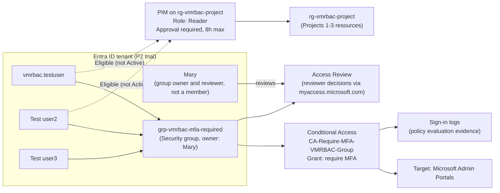

# Entra ID & Identity Management (Project 4 of 6)

Hands-on Microsoft Entra ID lab built for AZ-104 (Microsoft Azure Administrator) preparation. It covers identity governance on top of the environment from the earlier projects: users and groups, Conditional Access MFA, Privileged Identity Management (PIM) with approval, an Access Review, and sign-in log analysis.

Built in an Azure free-trial subscription with a **Microsoft Entra ID P2 trial** (required for PIM and Access Reviews; Conditional Access needs P1 or higher).

> Related repos: [VM-RBAC-Config](https://github.com/waynethedon/VM-RBAC-Config) (Project 1) · [VNet-Storage-Config](https://github.com/waynethedon/VNet-Storage-Config) (Project 2) · [Monitoring-Backup-Config](https://github.com/waynethedon/Monitoring-Backup-Config) (Project 3)

---

## Architecture

## What was built

| Requirement | Implementation |
|---|---|
| Tenant with multiple users/groups | 3 test users (group members) and a 4th user, Mary (group owner and Access Review reviewer), plus Security group `grp-vmrbac-mfa-required` with P2 licenses assigned |
| Conditional Access requiring MFA | `CA-Require-MFA-VMRBAC-Group`: targets the group, requires MFA for Microsoft Admin Portals. Validated in Report-only first, then switched On |
| PIM with approval | `vmrbac.testuser` and Test user2 made **Eligible** for Reader on `rg-vmrbac-project`. Full activation cycle tested with `vmrbac.testuser`. Activation requires approval (approver: Wayne), 8-hour maximum duration |
| Access Review | Review of `grp-vmrbac-mfa-required` membership (all 3 members). Reviewer: `MaryJane@waynethedon1outlook.onmicrosoft.com` (Mary). Decisions recorded 9/24/2026: `vmrbac.testuser` Approved; Test user2 and test user3 Denied, matching Entra's recommendations (both flagged as inactive) |
| Sign-in log review | Located and analyzed MFA authentication events, including which policy actually enforced MFA |

## Key decisions

**Report-only before On.** A misconfigured live MFA policy can lock out administrators. The policy was first run in Report-only mode, where it is evaluated but not enforced and results are written to the sign-in logs. After a test sign-in showed `Report-only: Success`, the policy was switched On.

**Target a group, not "All users".** Scoping the policy to `grp-vmrbac-mfa-required` limits blast radius in a lab tenant where the only admin account is my own. In production, Microsoft recommends broad targeting with break-glass accounts excluded instead.

**Microsoft Admin Portals as the target resource.** Microsoft's guidance for protecting Azure management targets **Windows Azure Service Management API**. That app didn't appear in this new trial tenant's picker, because Microsoft cloud apps only show up once their service principal exists in the tenant. Microsoft Admin Portals was used as a reliable alternative that covers the Azure portal and Entra admin center.

**Eligible, not Active.** PIM's value is removing standing access. Two test users are only *eligible* for Reader on `rg-vmrbac-project`. Each must request activation, get approval, and receive time-boxed access (8h maximum). (Note: `vmrbac.testuser` still has an active, permanent custom role from Project 1, `VM Operator - No Delete`, assigned at the **VM scope** (visible in vm1's Access control blade). It doesn't appear in PIM's view of `rg-vmrbac-project`, because PIM shows assignments at the selected scope and those inherited from above it, not assignments on child resources. In production, that standing assignment would be a candidate to move into PIM as well.)

**Why Reader.** In production, PIM is normally used for privileged roles (Owner, Contributor, User Access Administrator), where standing access is the real risk. Reader was chosen here as a low-risk role to demonstrate the eligible → request → approve → active workflow safely in a lab. The workflow is identical for higher-privilege roles.

**Group owner as reviewer.** The Access Review is assigned to the group's owner (Mary, a 4th user) rather than the admin who built it. This follows the delegated-review model Access Reviews is designed for: the owner, who knows whether members still need access, attests to it, while IT only configures and audits the review. Mary owns the group but isn't a member, so she never reviews her own access.

**Minimal-to-no Bicep for this project.** See [Why this project isn't in Bicep](#why-this-project-isnt-in-bicep).

## Challenges & troubleshooting

**License assignment failed: "invalid usage location".** Entra ID requires a Usage Location on a user before any license can be assigned, because some services aren't available in every country. Setting Usage Location on each user fixed it.

**Security Defaults and Conditional Access can't run together.** The tenant started with Security Defaults enabled, which is Microsoft's free, tenant-wide MFA baseline. A CA policy can be created in Report-only while Security Defaults is on, but the portal blocks switching it On until Security Defaults is disabled. Security Defaults was disabled before enabling the policy.

A related finding: the first MFA sign-in event I examined showed `MFA requirement satisfied by claim in the token`, and its Conditional Access tab attributed enforcement to **Security Defaults**, not my policy. That event came from *before* Security Defaults was turned off. A later sign-in (see Verification) shows the custom policy doing the enforcement. Lesson: always check **which** control produced the result in the log, not only whether MFA happened.

**Access Review showed "No access to review".** The first review was scoped to *Guest users only*. The test users are tenant members, not guests, so it returned 0 users. Recreating it with the correct scope showed all 3.

**Couldn't record decisions in the Azure portal.** The Identity Governance > Access reviews > Results view is an admin oversight view; the assigned reviewer (Mary) made the decisions from her own sign-in. Reviewer decisions (Approve / Deny / Don't know) are made in the **My Access portal** (`myaccess.microsoft.com`). The review also showed system-generated recommendations per user based on signals such as sign-in activity.

**PIM approval request didn't appear immediately.** After the test user requested activation, the pending request took a short time to appear for the approver. This was propagation delay, not misconfiguration.

## Verification

> Screenshots in [`/screenshots`](./screenshots).

1. **Users, group and licenses:** group membership and P2 license assignments. ``
2. **CA policy in Report-only:** before enforcement, a test sign-in by a group member produced a `Report-only: Success` result for the policy in the sign-in logs, confirming it targeted the right users and app. (Not screenshotted at the time; the policy has since been switched On, so this step is described rather than shown.)
3. **CA policy enforcing (On), 9/28/2026:** `vmrbac.testuser`'s sign-ins to Azure Portal show two **Interrupted** attempts (the MFA challenge) followed by **Success**. The successful event's Conditional Access tab lists `CA-Require-MFA-VMRBAC-Group`, grant control **Mfa**, result **Success**. My own admin sign-ins in the same window show the policy **Not Applied**, since I'm not in the targeted group. `` ``
4. **PIM full cycle (Reader, tested 9/28/2026):**
   - Eligible assignments on `rg-vmrbac-project`: Reader for VM RBAC Test User and Test user2, each with a one-year end date. ``
   - Test user submits activation; portal confirms the request is pending approval. ``
   - Approver sees the pending Reader request (requestor, reason, 8-hour window). ``
   - Request approved. ``
   - Test user's Active assignments tab: Reader, **State: Activated**, ending exactly 8 hours after approval. Eligibility remains, so the user can request again later. ``
5. **Access Review:** Results page (Entra admin center) showing outcome, recommended action, reviewer and date for all 3 members. `vmrbac.testuser`: Approved. Test user2: Denied. test user3: Denied. Results were **intentionally not applied**, so the Apply result column is empty and all 3 users remain group members. In production, applying (or enabling auto-apply) would remove Test user2 and test user3 from the group. This lab kept them so the CA policy continues to cover all 3 test users. ``

## How to reproduce (Portal)

1. **Licensing:** activate the Entra ID P2 trial in the existing tenant (Entra admin center > Billing > Licenses > All products > Try/Buy).
2. **Users:** create test users, set **Usage location** on each, then assign P2 licenses.
3. **Group:** create a Security group, add the test users as members and a separate user (the reviewer) as owner. Set the Access Review reviewer to **Group owner(s)** (shown afterwards on the review's Reviewers page as *Resource owners*).
4. **Conditional Access:** Entra ID > Conditional Access > New policy. Assign the group, target Microsoft Admin Portals (or Windows Azure Service Management API if listed), Grant > Require MFA, state **Report-only**. Test a sign-in and check the logs. Then disable Security Defaults (Entra ID > Overview > Properties > Manage security defaults) and set the policy **On**.
5. **PIM:** PIM > Azure resources > select the resource group > Settings for the role: require approval, set approver, max duration 8h. Then Assignments > Add > type **Eligible**.
6. **Test PIM:** as the test user, PIM > My roles > Activate. As approver, PIM > Approve requests.
7. **Access Review:** Identity Governance > Access reviews > New. Scope to members (not guests). Make decisions at `myaccess.microsoft.com`.
8. **Sign-in logs:** Entra ID > Monitoring > Sign-in logs. Open an event and check the Authentication Details and Conditional Access tabs.

## Why this project isn't in Bicep

Most of this project doesn't live in Azure Resource Manager. Users, groups, Conditional Access policies and Access Reviews are Microsoft Graph objects. They're normally automated with Graph PowerShell, Terraform's `azuread` provider, or the Microsoft Graph Bicep extension (limited resource coverage), not standard ARM templates.

**The exception is PIM for Azure resources.** Eligible assignments and activation settings are ARM resources (`Microsoft.Authorization/roleEligibilityScheduleRequests` and `Microsoft.Authorization/roleManagementPolicies`), so that piece *could* be codified. It was kept Portal-driven here because the AZ-104 exam tests the concepts and Portal configuration, not writing this syntax from memory.

## Next steps

- Codify the PIM eligible assignment and approval settings in Bicep using the ARM resource types above.
- Retarget the CA policy to **Windows Azure Service Management API** now that the tenant has used Azure management endpoints, so the policy also covers Azure CLI and PowerShell.
- Add a break-glass account excluded from all CA policies (standard production practice).
- Add **fallback reviewers** to the Access Review and a second group owner, so the review still has a reviewer if the owner's account is removed.
- Use the Conditional Access **What If** tool to test policy outcomes without a real sign-in.
